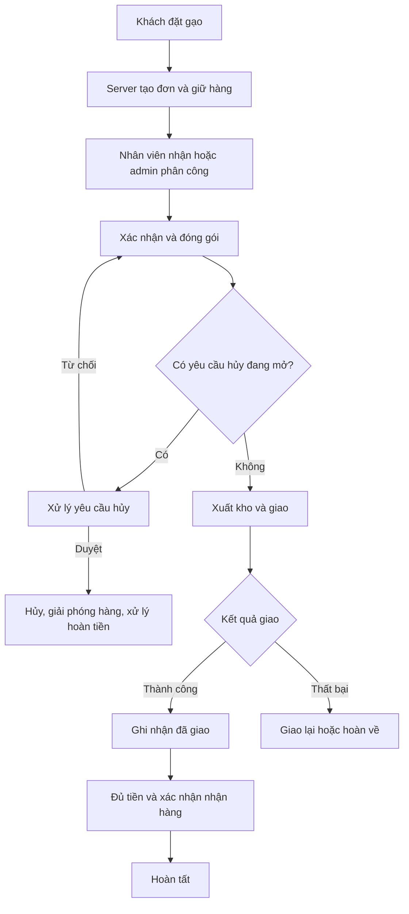

# Luồng khách hàng, admin và nhân viên — Website bán gạo

**Phiên bản:** 1.0 · **Ngày:** 31/10/2026  
**Đọc cùng:** `design.md` và `RULES.md`  
**Mục đích:** Chốt hành động, điều kiện, dữ liệu thay đổi và tiêu chí nghiệm thu cho từng vai trò.

## 1. Mô hình sử dụng

Bản đầu đề xuất một cửa hàng, một kho, bán gạo theo SKU đóng sẵn và giao tận nơi. Khách xem hàng tự do, đăng nhập khi đặt; nội bộ có admin và nhân viên. Giao hàng và đối soát tiền cập nhật thủ công, chưa nối hãng vận chuyển hoặc cổng thanh toán.

Đây là thiết kế cho dự án bán gạo, không phải luồng web QR. Không có số bàn, lượt ngồi hoặc phiếu pha chế. Các quy tắc chưa được chủ cửa hàng xác nhận được xem là mặc định đề xuất để dev có bản làm việc thống nhất.

### 1.1. Ai chịu trách nhiệm gì

| Vai trò | Công việc chính | Giới hạn |
| --- | --- | --- |
| Khách hàng / CUSTOMER | Chọn gạo, đặt, theo dõi, hủy theo điều kiện, xác nhận nhận | Chỉ dữ liệu của mình; không tự xác nhận tiền vào ngân hàng |
| Nhân viên / STAFF | Nhận đơn, xác nhận, đóng gói, bàn giao/giao, ghi COD, xử lý hủy trước giao | Chỉ đơn được phân công khi ghi; không sửa giá/kho trực tiếp/quyền hoặc đối soát chuyển khoản |
| Admin / ADMIN | Quản trị hàng, tồn, nhân sự, phân công, đối soát, hoàn tiền/hàng và báo cáo | Vẫn tuân thủ trạng thái, chống trùng và lưu lịch sử |

### 1.2. Liên kết công việc giữa các bên

Sơ đồ biểu diễn nghiệp vụ. Backend kiểm soát từng chuyển trạng thái; không dùng sơ đồ làm lý do cho phép nhảy bước tùy ý.

## 2. Luồng khách hàng

### U01 — Xem và tìm gạo

**Điều kiện:** Không cần đăng nhập.

1. Khách vào trang chủ hoặc danh sách sản phẩm.
2. Tìm theo tên, lọc loại gạo, quy cách và khoảng giá; sắp xếp theo lựa chọn có thật.
3. Mở chi tiết một loại gạo.
4. Xem mô tả, nguồn gốc nếu cửa hàng cung cấp, quy cách, giá và chính sách giao.

**Kết quả:** Chỉ trả hàng được công bố. Không có kết quả phải hiện trạng thái rỗng; API lỗi phải hiện lỗi. Không tự bịa chứng nhận, đánh giá, số lượt mua hoặc “bán chạy”.

### U02 — Chọn quy cách và thêm giỏ

1. Khách chọn SKU, ví dụ Bao 5 kg hoặc Bao 10 kg.
2. Giao diện đổi đồng thời ảnh phù hợp, nhãn, SKU, giá/bao, tồn khả dụng và số lượng được đặt.
3. Khách nhập số bao nguyên dương, xem tổng kg và thành tiền.
4. Bấm Thêm vào giỏ.

**Ví dụ:** 2 bao 5 kg, 135.000đ/bao → 10 kg, 270.000đ. Đây là dữ liệu minh họa, không phải giá bán đã chốt.

**Quy tắc:** Cùng SKU có thể gộp số lượng trong giỏ. Khác quy cách phải là hai dòng. Thêm giỏ chưa giữ tồn; số hàng còn có thể thay đổi trước checkout. SKU hết hàng không được thêm nhưng khách vẫn chọn được SKU khác còn bán.

### U03 — Đăng ký và đăng nhập

1. Khách xem giỏ và bấm tiếp tục.
2. Nếu chưa đăng nhập, chuyển đến login kèm đường quay lại; giữ giỏ nháp.
3. Khách đăng nhập hoặc đăng ký tài khoản CUSTOMER.
4. Backend kiểm tra dữ liệu, mật khẩu và phiên; frontend trở lại checkout.

**Form đề xuất:** Họ tên, email, điện thoại, mật khẩu và xác nhận mật khẩu khi đăng ký. Địa chỉ nhận nhập tại checkout hoặc lưu trong tài khoản. Không yêu cầu khách nhập role; không thêm OTP vào bản đầu.

**Lỗi:** Sai thông tin → báo chung, không lộ tài khoản. Tài khoản bị khóa/phiên không hợp lệ → không tạo đơn. Không có khôi phục mật khẩu tự động thật thì không hiển thị thông báo đã gửi email giả.

### U04 — Checkout và xác nhận tổng tiền

1. Khách nhập/chọn người nhận, điện thoại, địa chỉ và vùng giao từ cấu hình hiện hành.
2. Khách chọn COD hoặc chuyển khoản nếu cửa hàng đã bật.
3. Server trả quote: dòng SKU, số bao, tổng kg, tiền hàng, phí giao và tổng phải trả; có version/thời hạn.
4. Khách kiểm tra và bấm Đặt hàng.
5. Client gửi SKU/số bao, dữ liệu nhận hàng, phương thức và thông tin quote kèm idempotency key; tổng client không có quyền quyết định.
6. Server kiểm lại giá, phí, vùng, trạng thái SKU và tồn, tạo đơn PENDING và giữ hàng trong transaction.
7. Sau commit, frontend mở trang đặt thành công và dữ liệu đơn thật.

**Ngoại lệ:**

| Tình huống | Kết quả cần thấy |
| --- | --- |
| Ngoài vùng giao/chưa có phí hợp lệ | Chặn đặt, hướng dẫn chọn vùng hợp lệ hoặc liên hệ; không tạo đơn phí 0 giả |
| SKU hết/không đủ | Nêu dòng cần sửa; không tự giảm số lượng hoặc đổi loại |
| Giá/phí đổi | Hiện tiền mới, để khách xác nhận lại; chưa tự tạo đơn |
| Double click | Một đơn, một lần giữ tồn |
| Timeout sau gửi | Giữ request key, tra kết quả/thử lại đúng request; không báo thất bại chắc chắn rồi tạo đơn mới |
| Transaction lỗi | Không để đơn thiếu dòng, giữ tồn mồ côi hoặc trang thành công giả |

### U05 — Theo dõi đơn

Khách vào Đơn hàng của tôi → chọn đơn → xem dòng gạo/quy cách, tiền, địa chỉ snapshot, phương thức và timeline. API kiểm chủ đơn ở server, kể cả khi đổi ID trên URL.

Thông tin hiển thị tách biệt: **Đang giao / Chưa thu tiền** hoặc **Chờ xác nhận / Đã thanh toán** có thể đồng thời hợp lệ. Không gộp thành một badge gây hiểu nhầm.

Chưa có thông báo email/SMS/realtime thì việc theo dõi bằng tải lại/truy vấn dữ liệu hiện hành; không mô tả có thông báo tự động chưa triển khai.

### U06 — Hủy và yêu cầu hủy

| Trạng thái | Nút khách được dùng | Server thực hiện |
| --- | --- | --- |
| PENDING | Hủy đơn | Kiểm chủ đơn/trạng thái; hủy và giải phóng reserved một lần |
| CONFIRMED | Hủy đơn | Cùng quy tắc như PENDING |
| PACKING | Yêu cầu hủy | Tạo yêu cầu đang mở duy nhất; chưa giải phóng hàng |
| SHIPPING, DELIVERED, COMPLETED | Liên hệ hỗ trợ | Không cho API hủy trực tiếp |
| CANCELLED, RETURNING, RETURNED | Xem tình trạng | Không cho hủy lặp |

Khách chọn lý do và xác nhận trên hộp thoại có mã đơn. Hủy đã thu tiền tạo nghĩa vụ hoàn; màn hình nói rõ “Đơn đã hủy — Đang xử lý hoàn tiền”. Không hiển thị “đã hoàn tiền” chỉ vì đơn bị hủy.

Yêu cầu PACKING được duyệt/từ chối phải có kết quả và lý do trong lịch sử. Yêu cầu đang mở chặn xuất kho. Nếu nhân viên vừa xuất trước khi yêu cầu được lưu, server trả trạng thái mới; không ghi yêu cầu hủy trái điều kiện.

### U07 — Thanh toán

- **COD:** Khách trả khi nhận theo thỏa thuận giao; nhân sự nhận tiền ghi thu. Khách không có nút tự đổi PAID.
- **Chuyển khoản thủ công:** Trang đơn hiện thông tin nhận và nội dung tham chiếu đã cấu hình. Khách chuyển ngoài hệ thống; admin đối soát thực tế rồi xác nhận.
- Không coi việc mở app ngân hàng, tải QR hay bấm “tôi đã chuyển” là giao dịch thành công.
- Nếu đơn đã hủy mà tiền đến muộn, admin ghi nhận tiền thực và tạo yêu cầu hoàn; không tự phục hồi đơn cũ hoặc giữ hàng mới.

### U08 — Xác nhận nhận hàng

1. Chỉ khi đơn DELIVERED mới có hành động xác nhận nhận hàng.
2. Server kiểm chủ đơn và lưu thời điểm nhận đúng một lần.
3. Nếu đã thu đủ và không có vấn đề mở → COMPLETED.
4. Nếu chưa thu đủ → giữ DELIVERED, hiển thị đã ghi nhận nhận hàng và chờ đối soát. Khi ghi thu đủ sau đó, server kiểm lại để hoàn tất.

Khách không bấm thì đơn vẫn DELIVERED. Bản đầu không tự hoàn tất sau X ngày; admin có thể xác nhận thay khi đã kiểm chứng, bắt buộc ghi lý do và actor thật.

### U09 — Hồ sơ và yêu cầu đổi trả

Khách sửa hồ sơ/địa chỉ cho lần mua sau; không sửa snapshot đơn đã tạo. Đơn đã giao có vấn đề thì xem chính sách thật và liên hệ cửa hàng kèm mã đơn. Admin tiếp nhận vào hồ sơ đổi trả riêng; chưa có self-service đổi trả ở bản đầu.

Không tự đặt thời hạn đổi trả, điều kiện chất lượng hoặc cam kết hoàn tiền khi cửa hàng chưa cung cấp. Trang chính sách phải được chủ cửa hàng điền trước khi sử dụng thật.

## 3. Luồng nhân viên

### S01 — Đăng nhập và nhận công việc

1. Nhân viên dùng tài khoản do admin tạo, đăng nhập khu nội bộ.
2. Server trả vai trò và quyền hiện hành, frontend mở màn hình công việc.
3. Tab Chưa nhận hiển thị đơn chưa phân công và thông tin tối thiểu cần để nhận.
4. Bấm Nhận đơn: server gán assignee cho chính actor nếu đơn vẫn chưa được nhận.
5. Đơn xuất hiện tại Của tôi; admin có thể phân công trước, khi đó nhân viên không cần claim.

Hai người cùng nhận chỉ một người thành công. Người còn lại nhận thông báo đơn đã được nhận và tải lại. Không cho gửi `assigneeId` tùy ý để giành đơn người khác.

### S02 — Kiểm tra và xác nhận đơn

**Tiền điều kiện:** Đơn PENDING được phân công cho nhân viên, tài khoản và phiên hoạt động.

1. Mở chi tiết: mã đơn, SKU, số bao/tổng kg, địa chỉ, ghi chú và trạng thái tiền.
2. Kiểm tra khả năng giao theo cấu hình; không yêu cầu nhắn khách xác nhận lại cho mọi đơn nếu không cần.
3. Bấm Xác nhận → CONFIRMED; ghi actor/thời gian.
4. Nếu không thể thực hiện, hủy có lý do trước xuất; không đổi SKU hoặc tổng tiền ngầm.

Hàng đã được giữ từ checkout. Xác nhận không giữ thêm lần nữa. Chuyển khoản chưa PAID không bị coi là PAID chỉ vì nhân viên xác nhận đơn.

### S03 — Đóng gói

1. CONFIRMED → bấm Bắt đầu đóng gói → PACKING.
2. Soạn đúng mã SKU/quy cách và số bao theo phiếu; giao diện cho xem toàn đơn, không bắt bấm từng hạt/từng kg.
3. Kiểm tra bao bì và ghi chú cần giao.
4. Nếu có yêu cầu hủy đang mở, màn hình ưu tiên thông báo và chặn bàn giao xuất kho.

Nếu phát hiện thiếu hàng thực tế, liên hệ admin kiểm kho. Không tự sửa tồn hoặc đánh dấu đã xuất dù chưa có hàng. Quy trình hủy/tạo lại đơn được dùng nếu cần đổi sản phẩm ở bản đầu.

### S04 — Xử lý yêu cầu hủy lúc đóng gói

| Quyết định | Điều kiện | Tác động |
| --- | --- | --- |
| Duyệt | Chưa SHIPPING, hàng chưa ra khỏi kho | Đơn CANCELLED, đóng yêu cầu, giải phóng reserved một lần; tiền xử lý riêng |
| Từ chối | Có lý do vận hành hợp lệ, chưa xuất | Đóng yêu cầu với lý do; đơn vẫn PACKING, có thể tiếp tục giao |

Yêu cầu và thao tác xuất dùng kiểm soát đồng thời. Không để vừa duyệt hủy vừa xuất cùng một lượng hàng. Nhân viên ghi đúng quyết định, không tự xác nhận đã hoàn chuyển khoản.

### S05 — Bàn giao và giao hàng

1. PACKING, không có yêu cầu hủy mở → bấm Bàn giao đi giao.
2. Backend kiểm actor, version, trạng thái, reservation; giảm onHand/reserved và ghi xuất một lần → SHIPPING.
3. Ghi người/đơn vị thực sự nhận giao nếu có thông tin; phân biệt với tài khoản đang thao tác.
4. Khi có bằng chứng vận hành hàng đã đến người nhận, ghi Đã giao → DELIVERED.

Chưa có kết nối hãng vận chuyển thì không tạo mã vận đơn giả, tracking thời gian thực hoặc mô tả vị trí xe. Mọi cập nhật là ghi nhận thủ công có actor/thời gian.

### S06 — Thu tiền COD

1. Nhân viên được giao/admin thực nhận đủ số tiền còn phải thu.
2. Mở đúng đơn, kiểm số phải thu, chọn ghi nhận COD.
3. Server xác nhận phương thức COD, đơn đang SHIPPING hoặc DELIVERED, đúng quyền và chưa có khoản thu trùng; ghi số tiền thực.
4. Tiền thành PAID; giao hàng vẫn cần thao tác DELIVERED riêng nếu chưa có.

Tiền có thể được ghi trong cùng phiên thao tác lúc giao, nhưng thu và giao là hai sự kiện nghiệp vụ tách biệt. Lần bấm lặp trả kết quả hiện có, không cộng thêm tiền.

Nếu khách đưa thiếu: chưa ghi thu đủ. Bản đầu chưa hỗ trợ trả góp/thu thiếu; liên hệ admin xử lý, không giả PAID. Nhân viên không được xác nhận chuyển khoản ngân hàng bằng nút COD.

### S07 — Giao thất bại và hoàn về

1. Đơn SHIPPING giao chưa được: ghi lý do/lần thử, vẫn SHIPPING nếu còn giao lại.
2. Quyết định đưa hàng về: SHIPPING → RETURNING, ghi lý do.
3. Khi hàng về thực tế, nhân viên báo bàn giao kho; admin/quyền nhận hoàn ghi biên nhận, số bao theo SKU. Nhận đủ lượng cần hoàn mới chuyển RETURNED; nhận từng phần vẫn RETURNING.
4. Tồn chưa tăng. Admin kiểm hàng theo A07; tiền đã thu chuyển vào hồ sơ hoàn/đối soát khi phù hợp.

Nhân viên không bấm CANCELLED cho đơn đã xuất, không tự nhập lại hàng đang trên đường và không xóa lần giao thất bại.

### S08 — Kết thúc công việc

Nhân viên xem đơn còn lại của mình và sổ COD mình ghi theo phạm vi cho phép. Số COD đã ghi nhận không tự chứng minh đã nộp tiền quầy; bản đầu admin đối chiếu và ghi chú bàn giao theo thực tế, không có module két/ca thu ngân riêng.

Khóa tài khoản hoặc đổi phân công có hiệu lực server; tab đang mở không tiếp tục cập nhật bằng quyền cũ. Không dùng chung một tài khoản cho nhiều người nếu cần audit đúng actor.

## 4. Luồng admin

### A01 — Khởi tạo cửa hàng

1. Dev tạo admin đầu bằng lệnh chủ đích từ cấu hình riêng; không seed mật khẩu công khai.
2. Admin đăng nhập và điền tên, logo, liên hệ, địa bàn/phí giao và chính sách thực tế.
3. Chọn COD; chỉ bật chuyển khoản khi có thông tin nhận hợp lệ và người đối soát.
4. Tạo nhân viên cần thiết, không sinh hàng loạt tài khoản mặc định.

Không mang tên, số bàn, database, remote Git hay cấu hình của web QR sang dự án mới như thể đã được xác nhận.

### A02 — Tạo danh mục, gạo và SKU

1. Tạo danh mục, ví dụ gạo thơm/gạo dẻo nếu cửa hàng thực sự dùng.
2. Tạo sản phẩm: tên, slug, mô tả, đặc tính, nguồn gốc và ảnh phù hợp.
3. Tạo từng quy cách: SKU duy nhất, gram/bao, nhãn, giá/bao, ảnh, trạng thái bán.
4. Xem trước theo giao diện khách, kiểm đổi SKU đồng bộ.
5. Công bố sản phẩm sau khi dữ liệu và ảnh hợp lệ; nhập kho bằng A03.

SKU mới tồn bằng 0 cho đến khi có phiếu nhập hợp lệ. Sửa giá tác động lần mua sau, không sửa đơn cũ. SKU có lịch sử đơn ưu tiên ngừng bán, không xóa cưỡng bức.

### A03 — Nhập và điều chỉnh kho

1. Chọn SKU, xem onHand/reserved/available hiện hành.
2. Chọn Nhập hàng hoặc Điều chỉnh, nhập số bao, lý do và tham chiếu nếu có.
3. Backend validate quyền, số lượng và bất biến; tạo stock movement và cập nhật balance cùng transaction.
4. Hiển thị số trước/sau và người ghi.

Điều chỉnh giảm không được khiến onHand thấp hơn reserved. Nếu kiểm thực tế thiếu hàng đã giữ, dừng thao tác giảm và xử lý các đơn liên quan có dấu vết; không xóa reservation để hợp thức hóa tồn.

Chưa có bán cân lẻ hoặc đóng bao từ kho chung: không cho nhập “100 kg” rồi tự phân bổ ra mọi quy cách. Nếu cần mô hình đó, thiết kế thêm chuyển đổi/đóng gói riêng trước khi code.

### A04 — Quản lý và phân công đơn

Admin lọc đơn theo trạng thái/thời gian/nhân viên, xem chi tiết và timeline. Có thể tự xử lý như vận hành hoặc phân công cho STAFF.

- Gán lại nhân viên phải lưu người cũ/người mới/lý do; quyền ghi của người cũ bị thu hồi.
- Không sửa trạng thái tùy ý qua form tổng quát.
- Các nút hiển thị theo hành động hợp lệ; giao diện admin không bỏ qua điều kiện kho, yêu cầu hủy hoặc tiền.
- Đơn PENDING quá lâu có bộ lọc cảnh báo để xác nhận/hủy thủ công; bản đầu không tự hết hạn giữ tồn.
- Không sửa dòng hàng/tổng/địa chỉ đơn đã lưu; cần thay đổi trước xuất thì hủy/tạo lại có thỏa thuận với khách.

### A05 — Đối soát chuyển khoản

1. Mở danh sách đơn chuyển khoản chưa đối soát.
2. Kiểm tra tiền thực tại nguồn ngân hàng và tham chiếu đơn; không chỉ dựa ảnh khách gửi.
3. Chọn đúng đơn, ghi nhận đủ tiền với tham chiếu và thời điểm thực tế nếu có.
4. Backend chặn trùng tham chiếu trong phạm vi phù hợp, chặn thu vượt và ghi actor.
5. Đơn thành PAID; chưa tự thành DELIVERED. Nếu khách đã xác nhận nhận và các điều kiện còn lại đủ, server hoàn tất.

Thiếu tiền, thừa tiền hoặc tham chiếu không rõ: ghi nhận vấn đề đối soát, chưa ép vào giao dịch thu đủ của đơn. Đây là ngoại lệ cần xử lý thủ công, không có ví/số dư hoặc tự phân bổ tiền ở bản đầu.

Đơn đã hủy nhận chuyển khoản muộn: ghi tiền thật, mở yêu cầu hoàn; không khôi phục đơn, không xuất hàng theo đơn CANCELLED.

### A06 — Hủy và hoàn tiền

1. Kiểm tra trạng thái đơn và lý do hủy; chỉ hủy trực tiếp trước SHIPPING.
2. Transaction hủy giải phóng hàng một lần, lưu lịch sử; thanh toán tách riêng.
3. Nếu chưa thu → không có khoản tiền để hoàn.
4. Nếu đã thu → tạo yêu cầu hoàn gắn đơn, số được hoàn và lý do; hiển thị REFUND_PENDING.
5. Admin thực hiện hoàn theo phương thức phù hợp ngoài hệ thống nếu chưa có tích hợp.
6. Sau khi hoàn thực, ghi khoản hoàn và tham chiếu → REFUNDED hoặc PARTIALLY_REFUNDED theo số thực.

Không cộng lại hàng lần nữa khi ghi hoàn tiền. Không chuyển REFUNDED chỉ vì bấm duyệt. Thay đổi/lỗi giao dịch phải có bút toán điều chỉnh, không sửa/xóa lịch sử tiền.

### A07 — Nhận và kiểm hàng hoàn

Áp dụng cho hoàn do giao thất bại và hồ sơ đổi trả sau giao.

1. Mở hồ sơ nguồn, chọn SKU/số lượng dự kiến hoàn; giữ liên kết với đơn gốc.
2. Khi kho nhận thực, ghi số nhận và biên nhận; có thể nhận nhiều đợt nhưng tổng không vượt lượng được chấp thuận còn lại.
3. Hàng nhận nằm ở chờ kiểm, không available.
4. Kiểm bao bì/chất lượng theo quy định cửa hàng, phân số lượng đạt và không đạt, kèm lý do.
5. Lượng đạt tạo phiếu nhập lại đúng một lần; lượng không đạt ghi xử lý riêng, không nhập tồn bán.
6. Nếu có hoàn tiền, xử lý A06 theo số được duyệt; hàng và tiền có thể hoàn tất khác thời điểm.

Với đơn RETURNING, phải nhận đủ lượng cần hoàn mới chuyển RETURNED. Nếu thiếu/mất, mở hồ sơ ngoại lệ để admin xử lý; không âm thầm giảm lượng dự kiến hoặc ghi đã nhận đủ. Hồ sơ đổi trả sau giao có trạng thái xử lý riêng, không đẩy đơn gốc vào nhánh RETURNING.

Ví dụ minh họa: nhận 3 bao, 2 bao đạt và 1 bao rách → chỉ 2 bao tăng tồn bán. Retry không được nhập lại thêm 2 bao. Không sửa đơn COMPLETED về PENDING để xử lý đổi trả.

### A08 — Quản lý khách hàng và nhân viên

| Đối tượng | Admin được làm | Điều phải bảo vệ |
| --- | --- | --- |
| Khách | Xem thông tin cần thiết/lịch sử đơn, khóa khi có lý do | Không xem mật khẩu; khóa không xóa lịch sử đơn; dữ liệu cá nhân không đưa vào log công khai |
| Nhân viên | Tạo, đổi phân công, khóa, cấp quyền theo mô hình | Khóa thu hồi phiên; không cho tự nâng quyền từ request |
| Admin | Quản lý theo chính sách chủ cửa hàng | Không khóa/hạ quyền quản trị cuối cùng đang hoạt động |

Chưa có quy trình mời nhân viên qua email tự động thì không giả báo đã gửi thư. Cấp thông tin đăng nhập ban đầu bằng quy trình riêng được chủ cửa hàng đồng ý; không hardcode chung một mật khẩu vào tài liệu.

### A09 — Hoàn tất thay khách và xử lý ngoại lệ

Admin có thể ghi xác nhận nhận hàng thay khách sau kiểm chứng, kèm lý do. Hành động vẫn cần DELIVERED, thu đủ và không có vấn đề mở để đạt COMPLETED.

Nếu sai ghi nhận giao/thu, không bấm lùi trạng thái hoặc xóa lịch sử để che lỗi. Ghi hồ sơ điều chỉnh với dữ kiện, người xử lý và bút toán/tác động kho tương ứng. Trường hợp chưa được thiết kế phải được làm rõ trước khi thêm đường tắt vào production.

### A10 — Báo cáo và cấu hình

Admin xem giá trị đơn đặt, tiền thu, tiền hoàn, thu ròng, đơn hoàn tất và lượng xuất/nhập lại với định nghĩa trong RULES. Lọc theo thời gian kinh doanh Việt Nam; chưa có giá vốn thì không báo lợi nhuận.

Thay phí/vùng giao chỉ tác động quote/đơn mới; đơn đã lưu giữ snapshot. Tắt SKU hoặc vùng giao không tự hủy các đơn đang xử lý. Mọi thay đổi cần hiển thị tác động và lưu actor phù hợp.

## 5. Ma trận chuyển trạng thái đơn

| Từ → Đến | Ai khởi tạo | Tiền điều kiện/tác động |
| --- | --- | --- |
| Chưa có → PENDING | CUSTOMER | Giá/phí hợp lệ, đủ tồn; tạo đơn và reservation một lần |
| PENDING → CONFIRMED | STAFF được giao / ADMIN | Đúng version và quyền; không giữ tồn thêm |
| CONFIRMED → PACKING | STAFF được giao / ADMIN | Đúng bước, bắt đầu chuẩn bị |
| PACKING → SHIPPING | STAFF được giao / ADMIN | Không có yêu cầu hủy mở; xuất kho, giải phóng giữ trong transaction |
| SHIPPING → DELIVERED | STAFF được giao / ADMIN | Ghi nhận giao thành công, không mặc định PAID |
| DELIVERED → COMPLETED | Server sau xác nhận/đối soát | Đủ tiền + xác nhận nhận + không vấn đề mở |
| PENDING/CONFIRMED → CANCELLED | Chủ đơn / STAFF được giao / ADMIN | Kiểm trạng thái nguyên tử; giải phóng giữ; tiền riêng |
| PACKING → CANCELLED | STAFF được giao / ADMIN | Duyệt yêu cầu hoặc hủy có lý do trước xuất; đóng yêu cầu đang mở nếu có |
| SHIPPING → RETURNING | STAFF được giao / ADMIN | Quyết định hoàn về, chưa nhập lại tồn |
| RETURNING → RETURNED | ADMIN / quyền nhận hoàn | Đã nhận đủ lượng cần hoàn, có biên nhận; hàng ở chờ kiểm |

Yêu cầu hủy, lần thử giao, nhận tiền, xác nhận nhận và hồ sơ đổi trả là bản ghi/sự kiện riêng; không biến mỗi việc thành một trạng thái đơn mới.

## 6. Kịch bản nghiệm thu theo luồng

| Mã | Kịch bản | Kết quả bắt buộc |
| --- | --- | --- |
| E01 | Khách mua 2 bao 5 kg và 1 bao 10 kg | Hiện 3 bao, 20 kg; giá theo từng SKU |
| E02 | Hai khách mua cùng bao cuối | Một đơn đủ hàng thành công; đơn còn lại báo thiếu, không tồn âm |
| E03 | Bấm đặt hai lần/timeout gửi lại | Một đơn, một reservation, cùng kết quả |
| E04 | Admin đổi giá sau quote | Khách xác nhận tiền mới trước tạo đơn; không tăng ngầm |
| E05 | Hủy PENDING, gọi API hủy lại | reserved giải phóng một lần; không tăng onHand giả |
| E06 | Khách yêu cầu hủy PACKING, nhân viên bấm xuất | Request đang mở chặn xuất; kết quả đồng thời nhất quán |
| E07 | Hai nhân viên claim cùng đơn | Một assignee, một người thành công |
| E08 | STAFF đổi ID sang đơn người khác/sửa giá/đối soát bank | Backend từ chối, không chỉ ẩn nút |
| E09 | Khách sửa userId/role/orderId trong request | Không nâng quyền, không xem hoặc hủy đơn người khác |
| E10 | Đơn giao thành công chưa đối soát | DELIVERED và UNPAID cùng tồn tại; chưa COMPLETED |
| E11 | Khách nhận trước khi ghi thu; sau đó admin ghi đủ | Lưu nhận một lần, hoàn tất khi điều kiện đủ |
| E12 | Giao thất bại, hàng chưa về | Không cộng tồn bán; ghi lần thử hoặc RETURNING |
| E13 | Hàng hoàn 3 bao, 2 đạt, 1 hỏng | Chỉ nhập lại 2; retry không nhập thêm |
| E14 | Hủy đơn chuyển khoản đã thu | Hủy/giải phóng giữ; REFUND_PENDING đến khi thực hoàn |
| E15 | Hoàn tiền/thu tiền lặp hoặc vượt | Chặn hoặc trả kết quả cũ; số dư đúng |
| E16 | Khóa nhân viên khi tab còn mở | Phiên/quyền cũ không tiếp tục ghi dữ liệu |
| E17 | API lỗi/không có mạng ở checkout hoặc danh sách | Giữ dữ liệu, báo lỗi; không thành công hoặc rỗng giả |
| E18 | Xem trên mobile, chọn SKU và thao tác bàn phím | Không tràn trang, CTA không che nội dung, focus rõ |

Đây là tiêu chí cần chạy khi triển khai, chưa phải kết quả kiểm thử. Test dùng dữ liệu/tài khoản riêng; không dọn dữ liệu cửa hàng thật. Bàn giao ghi rõ mã luồng đã làm, kiểm tra đã chạy và phần còn thiếu.

## 7. Các điểm cần xác nhận khi áp dụng cho cửa hàng thật

Không cần chờ các câu trả lời này để chuẩn bị nền kỹ thuật theo mặc định, nhưng phải chốt trước khi bật tính năng tương ứng cho khách thật:

- Tên/logo/liên hệ, loại gạo, quy cách thực bán, giá và hình ảnh.
- Chỉ đóng bao sẵn hay có cân lẻ/sang bao; nếu có cân lẻ phải sửa mô hình kho trước triển khai phần đó.
- Địa bàn, cách tính phí theo đơn/khối lượng và khả năng giao; bản đầu dùng phí cấu hình theo vùng, server quyết định.
- COD hay thêm chuyển khoản; tài khoản nhận, người đối soát và quy trình hoàn tiền.
- Chính sách chất lượng, điều kiện/thời hạn đổi trả và cách xử lý bao hỏng.
- Stack/repository thực tế và tài khoản/môi trường test để dev kiểm chứng.

Không lấy giá trị minh họa trong tài liệu làm cấu hình kinh doanh production một cách tự động.
