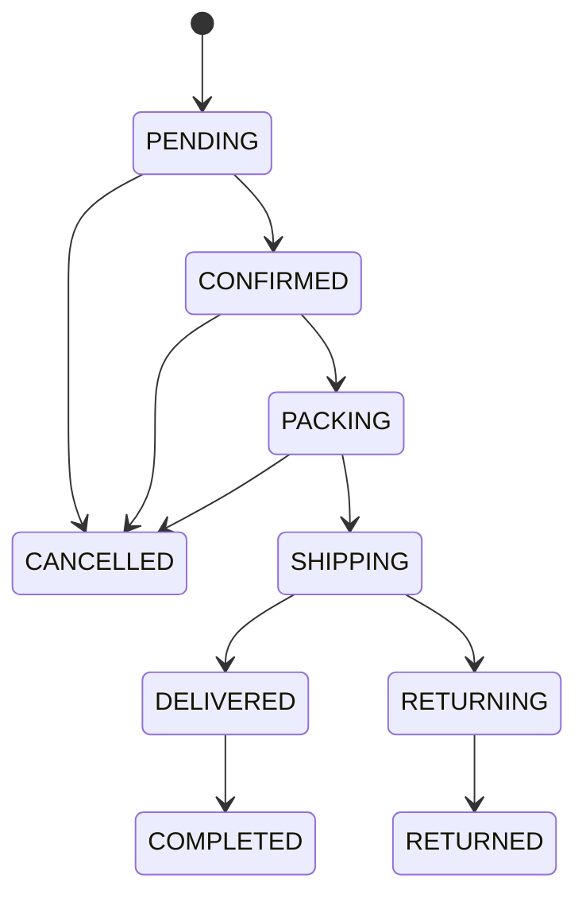

# design.md — Thiết kế website bán gạo

**Phiên bản:** 1.0 · **Ngày:** 31/10/2026  
**Đi cùng:** `RULES.md`, `LUONG_USER_ADMIN_NHAN_VIEN.md`  
**Mục đích:** Tài liệu thiết kế để dev xây giao diện, dữ liệu và API thống nhất.

## 1. Phạm vi và giả định

Yêu cầu hiện tại là website bán gạo có khách hàng, admin và nhân viên. Tài liệu kế thừa cách tổ chức, phân quyền và nghiệm thu của bộ tài liệu web QR; nghiệp vụ được thiết kế riêng cho bán gạo.

Các lựa chọn sau là **mặc định đề xuất**, chưa phải xác nhận về cửa hàng hoặc repository đang có:

| Nội dung | Mặc định phiên bản đầu |
| --- | --- |
| Mô hình | Một cửa hàng, một kho; bán lẻ online và giao tận nơi |
| Đơn vị bán | Túi/bao đóng sẵn theo SKU; ví dụ 5 kg, 10 kg, 25 kg |
| Khách hàng | Xem hàng không cần đăng nhập; đăng nhập để đặt và xem đơn |
| Vai trò | CUSTOMER, ADMIN, STAFF; không đăng ký STAFF/ADMIN công khai |
| Thanh toán | COD; chuyển khoản thủ công chỉ bật sau khi cấu hình tài khoản nhận |
| Giao hàng | Cửa hàng cập nhật thủ công, chưa tích hợp đơn vị vận chuyển |
| Địa bàn | Danh sách vùng giao và phí do admin cấu hình, server kiểm tra |
| Công nghệ | Nếu tạo mới: React + TypeScript + Vite, NestJS, TypeORM, MySQL; nếu có code thì kiểm tra và giữ stack phù hợp |

Chưa đưa vào phiên bản đầu: bán gạo cân lẻ, sang bao từ kho gạo chung, nhiều kho, giá sỉ/công nợ, voucher/VIP, tích điểm, AI tư vấn, live chat, đăng nhập xã hội, OTP, cổng thanh toán tự động hoặc hóa đơn điện tử. Chỉ mở rộng khi có nhiệm vụ riêng.

Tên thương hiệu tạm trong mockup là **Gạo Nhà**; không coi đây là tên cửa hàng đã được chốt. Không mang tên Nhóm 4, repo QR, số bàn, lượt ngồi hoặc hàng đợi pha chế sang sản phẩm này.

## 2. Trải nghiệm cần đạt

- Khách hiểu loại gạo, quy cách và giá trước khi mua.
- Một sản phẩm có nhiều quy cách; chọn quy cách phải đổi đúng giá, SKU, ảnh, tồn và trọng lượng.
- Giỏ ghi rõ số bao và tổng kg. Mua 2 bao 5 kg phải hiện 2 bao · 10 kg.
- Khách chỉ thấy đặt thành công sau khi backend tạo đơn và giữ hàng thành công.
- Nhân viên nhìn thấy công việc theo đơn, nhận xử lý và thao tác nhanh trên điện thoại.
- Admin kiểm soát sản phẩm, tồn kho, nhân viên, phí giao, thanh toán và báo cáo.

## 3. Định hướng giao diện

Phong cách: cửa hàng thực phẩm sạch, gần gũi, sáng, đọc rõ. Dùng ảnh hạt gạo, bao bì và bữa cơm thật phù hợp; không tự gắn chứng nhận, số lượng khách hoặc đánh giá giả.

### 3.1. Bảng màu và token

| Token | Màu | Vai trò |
| --- | --- | --- |
| `--color-primary` | `#166534` | Nút chính, liên kết, mục điều hướng đang chọn |
| `--color-primary-hover` | `#14532D` | Hover nút chính |
| `--color-primary-soft` | `#DCFCE7` | Nền chọn nhẹ; dùng chữ xanh đậm |
| `--color-page` | `#FFFBF2` | Nền tổng thể màu kem |
| `--color-surface` | `#FFFFFF` | Card, bảng, form |
| `--color-text` | `#1F2937` | Nội dung chính |
| `--color-muted` | `#4B5563` | Mô tả phụ |
| `--color-border` | `#D1D5DB` | Viền control và phân cách |
| `--color-accent` | `#FBBF24` | Điểm nhấn lúa chín; đi với chữ tối |
| `--color-danger` | `#B91C1C` | Lỗi, hủy, thao tác nguy hiểm |
| `--color-info` | `#1D4ED8` | Thông tin và trạng thái đang giao |

Tập trung token vào một nơi. Không hardcode lại màu mỗi trang. Màu trạng thái luôn kèm nhãn chữ/icon. Kiểm tra tương phản ở cặp màu sử dụng thực tế; không mặc định mọi màu trong bảng đều dùng được làm chữ trên mọi nền.

### 3.2. Chữ, khoảng cách và control

- Font hỗ trợ tiếng Việt tốt; ưu tiên system font hoặc một font đã có trong dự án, tránh tải nhiều họ font.
- Nội dung mặc định 16 px; chữ phụ 14 px; không dùng cỡ quá nhỏ cho giá và trạng thái.
- Thang khoảng cách: 4, 8, 12, 16, 24, 32, 48 px. Card radius khoảng 12 px, input/nút khoảng 8 px.
- Control thao tác chính cao tối thiểu 44 px theo tiêu chí dự án; có focus bàn phím rõ.
- Form có label thật, dấu `*` cho trường bắt buộc, lỗi tại trường và thông báo tổng khi cần.
- Drawer/modal có tiêu đề, nút đóng, quản lý focus, phím Escape và trả focus sau đóng.
- Tôn trọng thiết lập giảm chuyển động. Không dùng banner tự chạy liên tục làm che nội dung.

### 3.3. Bố cục responsive

| Khu vực | Desktop | Điện thoại |
| --- | --- | --- |
| Trang mua hàng | Header, tìm kiếm, menu; nội dung rộng tối đa khoảng 1200 px | Header gọn; tìm kiếm dễ chạm; giỏ luôn có thể truy cập |
| Danh sách gạo | Bộ lọc bên trái, lưới 3–4 cột | Lưới 2 cột khi đủ chỗ; bộ lọc trong drawer |
| Chi tiết gạo | Ảnh trái, thông tin/chọn quy cách phải | Ảnh trên; CTA cố định dưới, chừa khoảng không che nội dung |
| Admin | Sidebar và nội dung; bảng có phân trang | Sidebar thu gọn; bảng cuộn trong vùng riêng hoặc chuyển card |
| Nhân viên | Danh sách đơn và chi tiết | Card đơn, lọc nhanh, một hành động chính theo trạng thái |

Kiểm tra tại các chiều rộng đại diện 360, 390, 768, 1024 và 1440 px. Không để toàn trang cuộn ngang. Tìm kiếm có debounce phù hợp và hủy kết quả cũ để tránh hiển thị nhầm truy vấn.

## 4. Sơ đồ màn hình

### 4.1. Khách hàng

| Route đề xuất | Nội dung chính |
| --- | --- |
| `/` | Giới thiệu cửa hàng, danh mục gạo, sản phẩm được admin chọn, chính sách giao |
| `/san-pham` | Tìm kiếm, lọc loại gạo/quy cách/khoảng giá, sắp xếp, phân trang |
| `/san-pham/:slug` | Gallery, thông tin gạo, chọn SKU, giá, quy cách, số bao, thêm giỏ |
| `/gio-hang` | SKU đã chọn, đơn giá/bao, số bao, tổng kg, tạm tính |
| `/thanh-toan` | Người nhận, điện thoại, địa chỉ, vùng giao, phí và phương thức thanh toán |
| `/dat-hang-thanh-cong/:code` | Đơn đã lưu, số tiền, phương thức và bước tiếp theo; yêu cầu quyền xem đơn |
| `/tai-khoan/don-hang` | Đơn của chính khách, lọc trạng thái |
| `/tai-khoan/don-hang/:id` | Dòng hàng, tiền, timeline, hủy/yêu cầu hủy/xác nhận nhận theo điều kiện |
| `/tai-khoan` | Hồ sơ và địa chỉ; sửa địa chỉ không sửa đơn cũ |
| `/dang-nhap`, `/dang-ky` | Tài khoản khách; quay lại checkout và giữ giỏ sau đăng nhập |
| `/chinh-sach-giao-hang`, `/doi-tra`, `/lien-he` | Nội dung thật do cửa hàng cung cấp |

Trang chủ chỉ có mục có dữ liệu và quy tắc rõ: “Sản phẩm nổi bật” do admin chọn; không gọi “Bán chạy” nếu chưa có phép tính từ đơn hợp lệ. Không hiển thị flash sale, đánh giá hoặc hàng nghìn lượt mua giả.

### 4.2. Admin

Sidebar gồm: Tổng quan, Sản phẩm, Danh mục, Tồn kho, Đơn hàng, Khách hàng, Nhân viên, Thu tiền & hoàn tiền, Báo cáo, Cấu hình.

- Tổng quan: đơn chờ xử lý, đang giao, tồn khả dụng thấp, doanh số theo định nghĩa rõ.
- Tạo/sửa gạo: thông tin chung → quy cách/SKU → giá/ảnh → xem trước. Nhập kho là thao tác riêng có lý do, không giấu trong form sửa mô tả.
- Chi tiết đơn: sản phẩm, địa chỉ snapshot, thanh toán, nhân viên phụ trách, lịch sử. Chỉ hiện hành động hợp lệ.
- Tồn kho: tồn thực tế, đang giữ, khả dụng, lịch sử nhập/xuất/điều chỉnh và hàng hoàn chờ kiểm.
- Nhân viên: tạo, khóa, phân công; không hiển thị mật khẩu đã lưu.
- Thu tiền: tách COD, chuyển khoản, số đã thu, số đã hoàn và số còn phải xử lý.

### 4.3. Nhân viên

Khu `/nhan-vien`: tab “Chưa nhận”, “Của tôi”, “Đang giao”, “Tra cứu”. Chi tiết có mã đơn, thời gian, số bao/tổng kg, người nhận và hành động theo quyền.

Nhân viên tự nhận đơn chưa phân công bằng thao tác nguyên tử; admin có thể phân công lại với lịch sử. Nhân viên được thay trạng thái đơn của mình, ghi nhận COD của đơn được giao. Không sửa giá, tồn trực tiếp, vai trò hoặc xác nhận chuyển khoản ngân hàng.

Danh sách đơn chưa nhận chỉ lộ thông tin vận hành cần thiết; địa chỉ/điện thoại đầy đủ chỉ trả cho người được phép xem chi tiết. Không gửi dữ liệu nhạy cảm xuống trình duyệt rồi chỉ ẩn bằng CSS.

## 5. Thiết kế sản phẩm và số lượng

| Đối tượng | Dữ liệu |
| --- | --- |
| Product | Tên loại gạo, slug, danh mục, mô tả, xuất xứ nếu có, đặc tính, cách bảo quản, trạng thái công bố |
| SKU | Mã duy nhất, productId, nhãn quy cách, trọng lượng gram/bao, giá VNĐ/bao, ảnh, trạng thái bán |
| Inventory | Tồn thực tế và đang giữ theo SKU; khả dụng = tồn thực tế − đang giữ |
| Cart item | skuId + số bao; giá hiển thị được đối chiếu server khi checkout |
| Order item | Snapshot tên, mã SKU, quy cách, gram/bao, đơn giá/bao, số bao và thành tiền |

Ví dụ dữ liệu minh họa: “Gạo thơm — Bao 5 kg”, mã `GAO-THOM-5KG`, 135.000đ/bao. Giá này chỉ dùng seed/demo có nhãn, không phải báo giá thị trường.

- 2 bao × 5.000 g = 10.000 g = 10 kg; 2 × 135.000đ = 270.000đ.
- Giá/kg có thể hiển thị tham khảo: 27.000đ/kg. Giá tính tiền vẫn là 135.000đ/bao.
- Mỗi quy cách có tồn độc lập. Bao 5 kg không được bán bằng cách tự trừ kho bao 25 kg.
- Hết quy cách đang chọn phải báo đúng quy cách đó; không báo cả loại gạo hết nếu SKU khác còn.
- Ẩn SKU không xóa dữ liệu dòng đơn cũ; khi đổi trọng lượng vật lý phải tạo SKU mới, tránh đổi ý nghĩa hàng tồn.

## 6. Đơn hàng và thanh toán

### 6.1. Trạng thái đơn

| Mã | Nhãn | Điều kiện chính |
| --- | --- | --- |
| PENDING | Chờ xác nhận | Đơn lưu thành công và giữ tồn đủ |
| CONFIRMED | Đã xác nhận | Nhân sự xác nhận có thể xử lý |
| PACKING | Đang đóng gói | Đã bắt đầu chuẩn bị hàng |
| SHIPPING | Đang giao | Bàn giao hàng ra khỏi kho; ghi xuất kho một lần |
| DELIVERED | Đã giao | Nhân sự ghi nhận giao thành công, chưa mặc định đã thu tiền |
| COMPLETED | Hoàn tất | Đã giao, có xác nhận nhận hàng của khách/admin và đã thu đủ, không có vấn đề đang mở |
| CANCELLED | Đã hủy | Hủy trước giao, giải phóng giữ tồn, xử lý tiền riêng |
| RETURNING | Đang hoàn về | Giao thất bại và đã quyết định đưa hàng về kho |
| RETURNED | Đã nhận hàng hoàn | Kho đã nhận đủ lượng cần hoàn; chưa đồng nghĩa được bán lại hoặc hoàn tiền xong |

Giao chưa thành công có thể ghi một lần giao thất bại và vẫn giữ SHIPPING để giao lại. Chỉ đổi RETURNING khi quyết định hoàn về; đơn RETURNING không có nhánh tự chuyển lại SHIPPING trong phiên bản đầu.

Nhận hoàn nhiều đợt được ghi bằng biên nhận; đơn giữ RETURNING đến khi nhận đủ lượng cần hoàn. Thiếu/mất hàng là ngoại lệ mở cần admin xử lý có hồ sơ, không tự sửa lượng dự kiến để đánh dấu nhận đủ.

Đổi trả sau DELIVERED/COMPLETED được quản lý bằng hồ sơ đổi trả riêng; không đổi ngược lịch sử đơn để giả lập chưa giao. Phiên bản đầu tiếp nhận qua liên hệ và admin tạo hồ sơ, chưa có portal đổi trả tự động.

### 6.2. Trạng thái tiền độc lập

Thanh toán lưu số phải thu, các lần thu hợp lệ và các lần hoàn thực tế. Nhãn tiền được tính từ sổ thu/hoàn: UNPAID, PAID, REFUND_PENDING, PARTIALLY_REFUNDED, REFUNDED. Phiên bản đầu không thu trả góp; hoàn một phần chỉ dùng hồ sơ đổi trả được duyệt.

- COD: nhân viên được giao đơn/admin xác nhận sau khi đã nhận đủ tiền; kèm thời điểm, số tiền và người ghi nhận.
- Chuyển khoản: chỉ admin/quyền đối soát xác nhận khi kiểm tra tiền thực vào tài khoản. Khách bấm “đã chuyển” hoặc gửi ảnh không làm đơn PAID.
- Chưa tích hợp webhook thì không mô tả xác nhận là tự động. Không hiển thị QR thanh toán nếu chưa có tài khoản nhận hợp lệ.
- Hủy đơn đã thu chuyển khoản → tạo nghĩa vụ hoàn; chỉ REFUNDED khi thực sự hoàn và lưu đối soát.
- Khách xác nhận nhận hàng khi còn UNPAID → lưu xác nhận nhận, thông báo chờ đối soát; khi thu đủ, server đánh giá lại điều kiện hoàn tất.
- Mỗi lần xác nhận thu/hoàn có chống trùng, không thể thu hoặc hoàn vượt số được phép.

### 6.3. Quy tắc hủy

| Tình trạng | Khách | Admin/nhân viên có quyền |
| --- | --- | --- |
| PENDING, CONFIRMED | Hủy trực tiếp, có lý do | Hủy có lý do; giải phóng tồn trong cùng transaction |
| PACKING | Gửi yêu cầu hủy | Duyệt nếu hàng chưa xuất; hoặc từ chối có lý do |
| SHIPPING trở đi | Không hủy trực tiếp | Ghi giao thất bại/hoàn hàng/đổi trả đúng quy trình |

Yêu cầu hủy đang mở tại PACKING chặn thao tác chuyển SHIPPING cho đến khi được xử lý. Nếu hủy và xuất kho diễn ra đồng thời, backend khóa/kiểm tra phiên bản; chỉ một thao tác hợp lệ được commit.

## 7. Giữ tồn, xuất kho và hàng hoàn

1. Checkout thành công: tăng `reserved` theo số bao trong transaction tạo đơn. Chưa giảm `onHand`.
2. Trước SHIPPING: hủy đơn giải phóng `reserved` đúng một lần.
3. Chuyển SHIPPING: đồng thời giảm `onHand` và `reserved`; tạo phiếu xuất duy nhất theo đơn/dòng hàng.
4. Giao thất bại: không tự cộng lại kho khi hàng còn ngoài đường.
5. Kho nhận hàng hoàn: ghi biên nhận và số lượng vào vùng chờ kiểm, giữ khả năng truy vết theo đơn.
6. Admin kiểm tra: phần đủ điều kiện mới nhập lại tồn bán; phần rách, ẩm hoặc hỏng ghi nhận riêng. Mỗi lượng hàng chỉ được xử lý một lần.

`onHand` chỉ tính hàng đủ điều kiện bán tại kho; hàng hoàn chờ kiểm nằm ở sổ riêng. Bất biến: `onHand >= reserved >= 0`. Nhập/điều chỉnh giảm không được làm tồn thực tế thấp hơn lượng đã giữ.

Phiên bản đầu giữ tồn đến khi hủy/xuất kho, chưa có hết hạn tự động. Admin có danh sách đơn chờ lâu để xử lý. Nếu thêm timeout phải xác định ảnh hưởng của thanh toán muộn, job chạy lại và race condition; không tự thêm timer trong frontend.

## 8. Dữ liệu và API đề xuất

### 8.1. Nhóm bảng

| Nhóm | Bảng/đối tượng đề xuất |
| --- | --- |
| Danh tính | users, auth_sessions, addresses |
| Hàng hóa | categories, products, product_skus, product_images |
| Kho | inventory_balances, stock_movements, inventory_reservations |
| Đơn | orders, order_items, order_events, cancellation_requests |
| Tiền | payment_entries, refund_requests, refund_entries |
| Hoàn hàng | return_cases, return_items, return_receipts, return_inspections |
| Cấu hình | delivery_zones, store_settings |
| Truy vết | audit_logs, idempotency_records |

Vấn đề mở của đơn phải có dữ liệu server bền vững, ví dụ hồ sơ ngoại lệ/đổi trả/đối soát với trạng thái OPEN và RESOLVED; không dùng một cờ chỉ nằm trong UI. Đóng vấn đề có actor/lý do và kích hoạt kiểm tra lại điều kiện hoàn tất nếu đơn đang DELIVERED.

Đây là mô hình logic; dev có thể gộp bảng hợp lý nhưng phải giữ bất biến và lịch sử. Không sinh bảng/file rỗng chỉ để đủ tên. Khóa ngoại và unique constraint phải bảo vệ dữ liệu thực, không chỉ có kiểm tra ở UI.

Giá, phí và tổng tiền: số nguyên VNĐ. Mặc định DB `DECIMAL(18,0)`, truyền qua API dạng chuỗi số nguyên, tính nội bộ bằng BigInt hoặc công cụ số nguyên chính xác. Frontend định dạng theo chuỗi/formatter chính xác; không dùng `parseFloat` để tính tiền. Trọng lượng cơ sở gram nguyên, số bao nguyên dương.

### 8.2. Hợp đồng tối thiểu

| API đề xuất | Hành vi/quyền |
| --- | --- |
| `GET /products`, `GET /products/:slug` | Public; chỉ hàng công bố và trường dữ liệu cho khách |
| `POST /auth/register`, `/auth/login`, `/auth/refresh`, `/auth/logout` | Đăng ký CUSTOMER; login chung, quyền server quyết định |
| `GET /auth/me` | Hồ sơ và quyền hiện hành |
| `POST /checkout/quote` | Khách đăng nhập; tính giá/phí/vùng giao hiện hành; không giữ tồn |
| `POST /orders` | Khách đăng nhập; kiểm quote/giá/tồn, giữ hàng và tạo đơn chống trùng |
| `GET /me/orders`, `GET /me/orders/:id` | Chỉ đơn của chủ tài khoản |
| `POST /me/orders/:id/cancel` | Hủy hoặc tạo yêu cầu hủy theo trạng thái |
| `POST /me/orders/:id/received` | Ghi nhận nhận hàng, kiểm điều kiện hoàn tất |
| `GET /operations/orders` | Danh sách theo scope nội bộ, không trả PII quá quyền |
| `POST /operations/orders/:id/claim` | Nhận đơn chưa phân công nguyên tử |
| `POST /operations/orders/:id/transitions` | Hành động có tên và version kỳ vọng; không cập nhật status tùy ý |
| `POST /operations/orders/:id/collect-cod` | Người được phân công/admin; ghi nhận thu tiền thực |
| `/admin/products`, `/admin/inventory`, `/admin/staff` | Permission quản trị tương ứng |
| `/admin/payments`, `/admin/refunds`, `/admin/returns` | Đối soát và xử lý tiền/hàng hoàn |

Dev cần chốt DTO, pagination, error code và route thực tế trước implementation. Không coi bảng này là endpoint đã tồn tại. Quote có version/thời hạn; tạo đơn vẫn kiểm tra lại mọi điều kiện.

Lỗi cần phân biệt: hết hàng, giá/phí đã đổi, ngoài vùng giao, không có quyền, trạng thái xung đột, idempotency key trùng payload khác, lỗi mạng. Trả đúng HTTP status và mã lỗi ổn định, không đổi tất cả thành 200 hoặc mảng rỗng.

## 9. Trạng thái UI và tính đúng

| Trường hợp | Giao diện phải thể hiện |
| --- | --- |
| Đang tải | Skeleton/spinner phù hợp; không hiện “không có dữ liệu” sớm |
| Không có gạo phù hợp | Gợi ý bỏ lọc, không báo lỗi hệ thống |
| API lỗi | Thông báo lỗi và thử lại; giữ giỏ/nội dung đã nhập |
| Gửi đơn chưa rõ kết quả | Tra lại bằng khóa request; không tạo đơn mới ngay |
| Giá/phí đổi | Hiện phần thay đổi và yêu cầu xác nhận lại trước tạo đơn |
| SKU hết hàng | Báo đúng dòng, giữ các dòng còn lại để khách sửa |
| Hai nhân viên cùng nhận/cập nhật | Người thua nhận thông báo dữ liệu đã đổi và tải lại |
| Đăng nhập hết hạn | Refresh phối hợp; nếu cần login lại thì giữ giỏ và đường quay về |

Không tự thay bằng loại gạo khác, tự giảm số bao, tự tăng tổng tiền hoặc giả báo đã thu tiền để qua luồng.

## 10. Thứ tự triển khai và nghiệm thu

| Giai đoạn | Đầu ra cần kiểm chứng |
| --- | --- |
| 1. Khảo sát | Cấu trúc thật, stack, migration, kế hoạch và phạm vi mặc định được ghi rõ |
| 2. Nền | Auth/RBAC, danh mục, sản phẩm/SKU, ảnh, nhập tồn |
| 3. Mua hàng | Catalog → chọn quy cách → giỏ → quote → tạo đơn/giữ tồn |
| 4. Vận hành | Nhận/phân công → xác nhận → đóng gói → xuất kho → giao → thu tiền/nhận hàng |
| 5. Ngoại lệ | Hủy, hoàn tiền, giao thất bại, nhận hoàn/kiểm hàng |
| 6. Hoàn thiện | Báo cáo, responsive, accessibility, test đầu cuối và bàn giao |

Nghiệm thu tối thiểu: chọn 5/10 kg đổi đồng bộ; tiền và tổng kg chính xác; không oversell khi hai khách mua bao cuối; gửi lại không nhân đôi đơn; hủy không hoàn tồn hai lần; nhân viên không sửa giá/quyền; không xem đơn khách khác; SHIPPING không tự cộng kho khi giao thất bại; lỗi API không hiện thành công giả.

Tài liệu này là bản thiết kế, chưa chứng minh website đã được lập trình hoặc kiểm thử.
